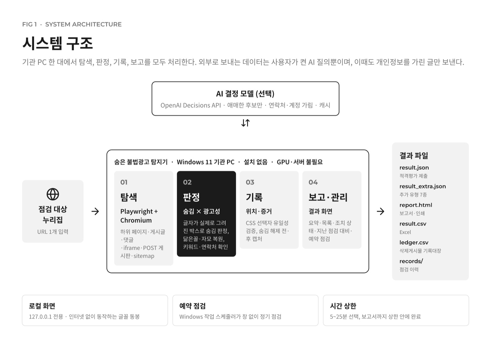
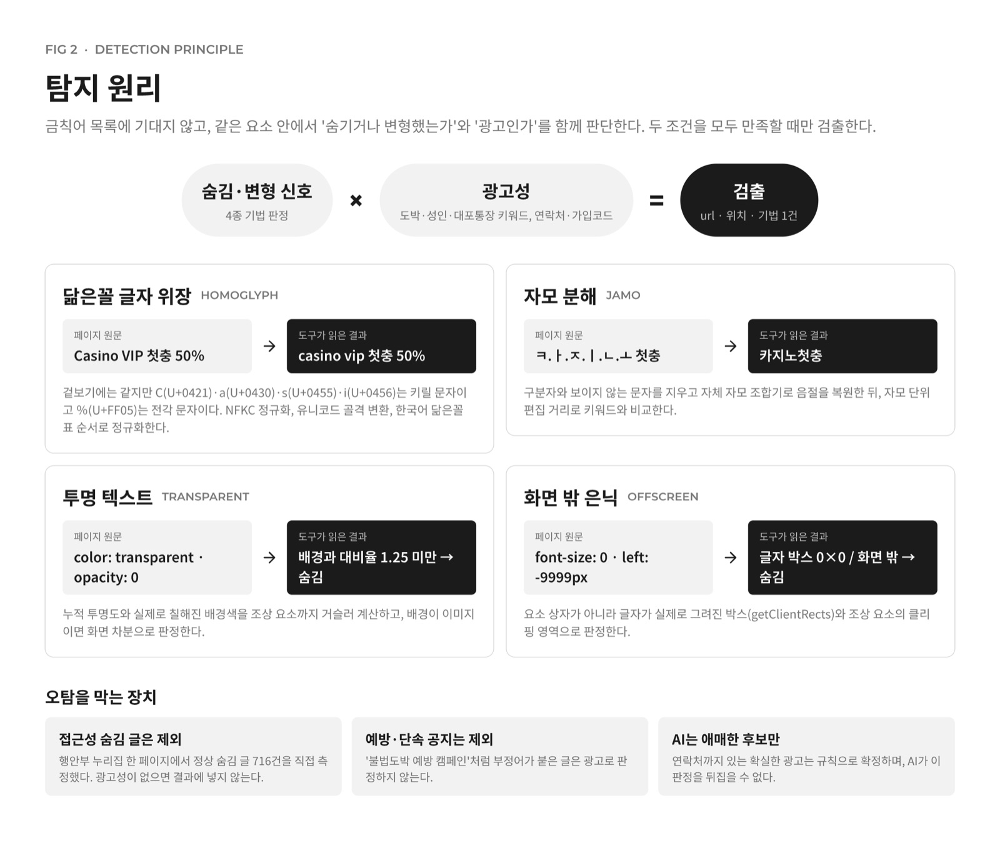
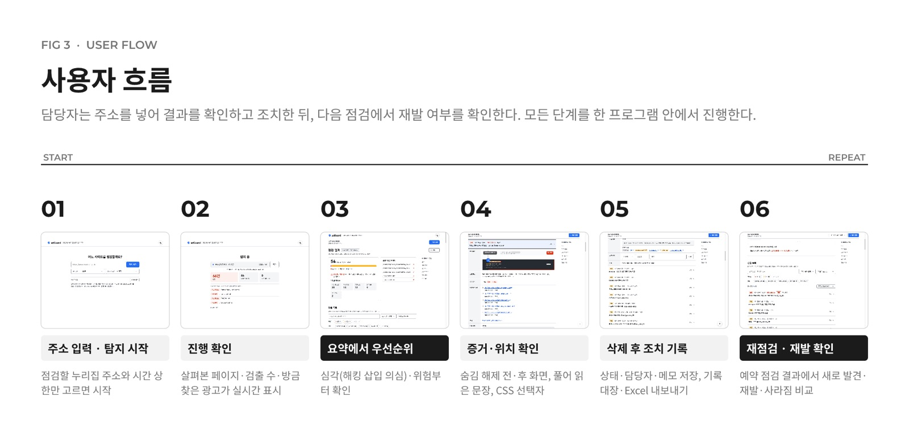
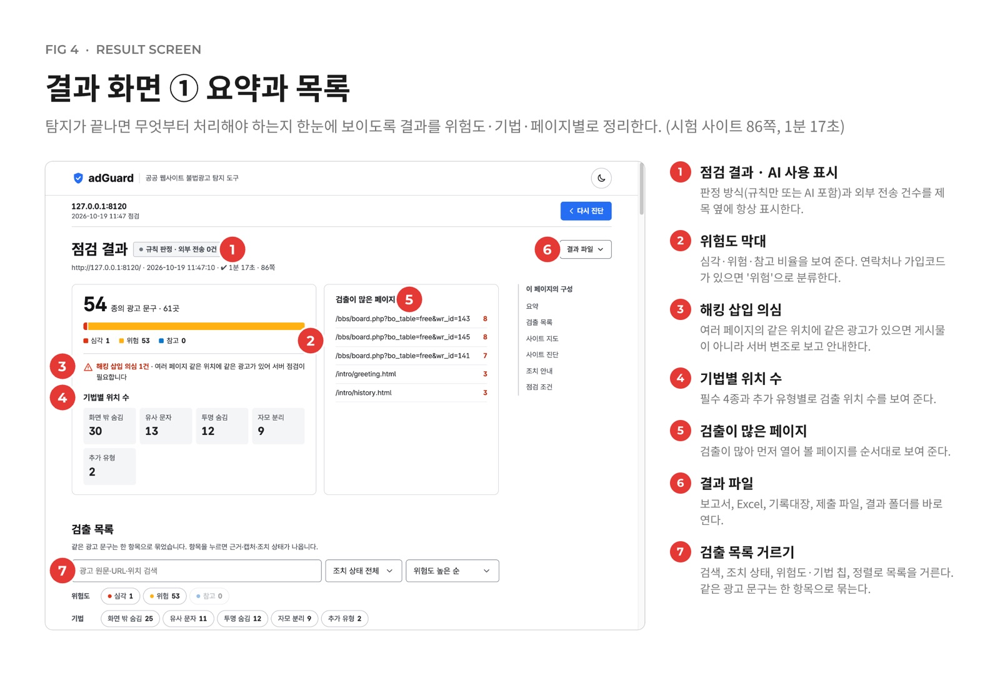
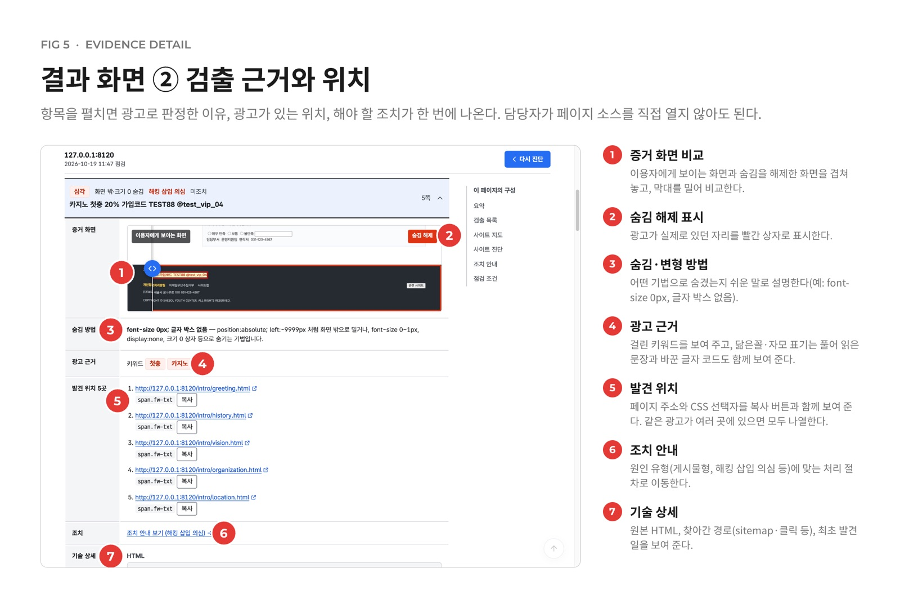
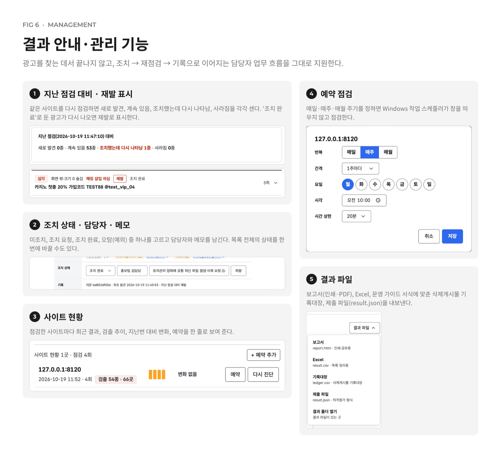

# 숨은 불법광고 탐지기 (adGuard)

공공 누리집 주소 1개를 넣으면 하위 페이지·게시글·댓글·iframe까지 찾아가, 닮은꼴 글자·자모 분해·투명 텍스트·화면 밖 은닉으로 숨긴 불법광고(도박·성인물 등)를 찾아 유형과 위치를 알려 주는 Windows 도구이다.
「공공 웹사이트 불법광고 탐지 도구 개발 공모전」(행정안전부 주최, NIA 주관) 출품작이며, 목표와 평가 기준은 [docs/GOAL.md](docs/GOAL.md)에 있다.

- 설치 없이 실행 파일 하나로 동작한다. GPU·서버가 필요 없다
- 찾는 데서 끝나지 않고 증거 확인 → 조치 → 재발 확인 → 기록대장까지 담당자 업무를 이어 준다
- AI는 선택이다. 키가 없으면 규칙만으로 판정하고, 키가 있으면 애매한 후보만 묻는다

**내려받기**: [Releases v1.0.0](https://github.com/Bongseop-Kim/adGuard/releases/tag/v1.0.0)의 `adguard.zip`을 풀고 `adguard\adguard.exe`를 실행한다.
사용설명서와 실행·빌드 매뉴얼은 [docs/submit/](docs/submit/)에 있다.



## 탐지 원리

같은 요소 안에서 "숨기거나 변형했는가"와 "광고인가"를 함께 보고, 둘 다 맞을 때만 검출한다. 숨김은 요소가 아니라 글자가 실제로 그려진 박스로 판정한다.



| 기법 | 판정 |
|---|---|
| HOMOGLYPH 닮은꼴 글자 | NFKC → 유니코드 골격 → 한국어 닮은꼴 표로 정규화해 키워드와 비교 |
| JAMO 자모 분해 | 구분자·보이지 않는 문자를 지우고 자체 조합기로 음절 복원 |
| TRANSPARENT 투명 텍스트 | 누적 투명도, 실제로 칠해진 배경과의 대비율(1.25 미만) |
| OFFSCREEN 화면 밖 은닉 | 글자 박스 0, font-size 1px 이하, 화면·조상 클리핑 밖, display:none |
| 추가 7종 (`result_extra.json`) | 그대로 보이는 광고, 보이지 않는 문자, 주석·속성 속 광고, 화면 순서 뒤집기, 내부 검색 반사, 검색봇 클로킹 |

## 화면









## 사용 (Windows)

| 실행 | 동작 |
|---|---|
| `adguard.exe` (더블클릭) | 창에서 URL 입력 → "탐지 시작" |
| `adguard.exe <URL>` | 창 없이 탐지하고 파일만 쓴다 (채점용) |
| `adguard.exe --no-report <URL>` | 탐지와 result.json·result_extra.json만 쓰고 보고서·캡처는 건너뛴다 |

결과는 exe와 같은 폴더에 생긴다.

- `result.json`: 채점용 결과 (4종)
- `result_extra.json`: 필수 4종 밖 추가 유형 (technique `ETC` + `extra_finding`: `VISIBLE_AD`, `INVISIBLE_CHAR`, `HTML_COMMENT_AD`, `ATTR_META_AD`, `VISUAL_REORDER`, `ISAP_SEARCH_REFLECTION`, `CLOAKING`). 클로킹 비교는 탐지 뒤에 돌아 `--no-report`에서는 빠진다
- `report.html`: 단일 파일 보고서 (브라우저로 연다)
- `result.csv`: Excel용 (UTF-8 BOM)
- `history.json`: 지문별 최초 발견일
- `status.json`: 지문별 조치 상태·담당자·메모 (다음 점검의 '지난 점검 대비'에 쓰임)
- `ledger.csv`: 삭제게시물 기록대장 ("조치 완료" 항목)
- `schedules.json`: 예약 점검 목록 (Windows 작업 스케줄러가 `adguard.exe --scheduled <id>`로 실행)
- `records/`: 점검 기록, `logs/`: 창 모드 진행 기록

AI(선택)는 `.env`의 `OPENAI_API_KEY`로 켠다. 서비스는 OpenAI Decisions API, 모델은 `gpt-6-luna`이며, 자세한 내용은 사용설명서 첫 장에 있다.

## 개발 실행 (macOS·Windows 공용)

```bash
uv venv && source .venv/bin/activate
uv pip install -r requirements.txt
playwright install chromium

python app/main.py                 # 화면 모드
python app/main.py <URL>           # 명령줄 모드
```

- 맥에서는 pywebview가 macOS 기본 WebKit 창을 띄운다. 창이 뜨지 않으면 기본 브라우저(`127.0.0.1` 주소)로 연다. 화면과 흐름은 Windows와 같다
- 결과 파일은 `app/` 폴더에 생긴다

## 자체 평가 (eval)

```bash
python eval/scenarios/S1-baseline/serve.py                  # 테스트 사이트 (http://127.0.0.1:8110)
python app/main.py http://127.0.0.1:8110/                   # 다른 터미널에서 탐지
python eval/scorer/score.py S1-baseline app/result.json     # 채점
python eval/validate.py app/result.json                     # 스키마 검사
```

시나리오 목록, 포트, 정답표 형식은 [eval/README.md](eval/README.md)를 본다. `eval/blind/`는 개발 중에 열어 보지 않는다.

## Windows 빌드

push할 때마다 GitHub Actions(`.github/workflows/windows-build.yml`)가 PyInstaller onedir로 빌드한다. Chromium은 exe 옆 `browsers/` 폴더에 함께 넣는다. 빌드한 exe를 한글·공백이 든 경로로 옮겨 명령줄 모드와 창 모드를 모두 실행해 본다.
결과물은 Actions 실행 페이지의 artifact `adguard-windows`에서 받는다. 제출본은 [Releases](https://github.com/Bongseop-Kim/adGuard/releases)에 있다.

## 구조

```
app/      main.py(진입점·화면) crawler.py(탐색) detect.py(탐지 4종) report.py(보고서) data/ui.html
eval/     테스트 사이트·정답표·채점기
docs/     GOAL.md, submit/(사용설명서·빌드 매뉴얼), images/(README 그림), research/(조사), todo/(남은 일), done/(완료 기록)
```
